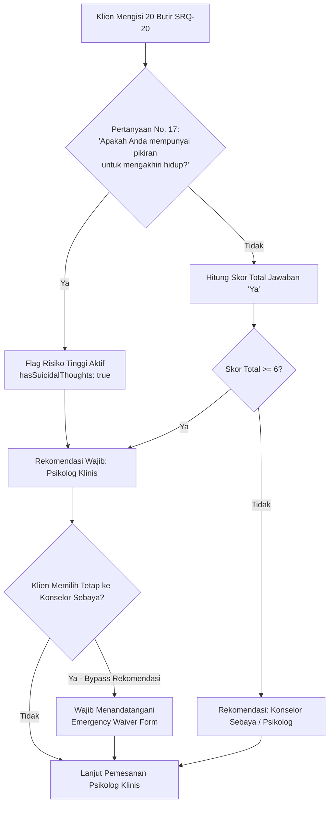
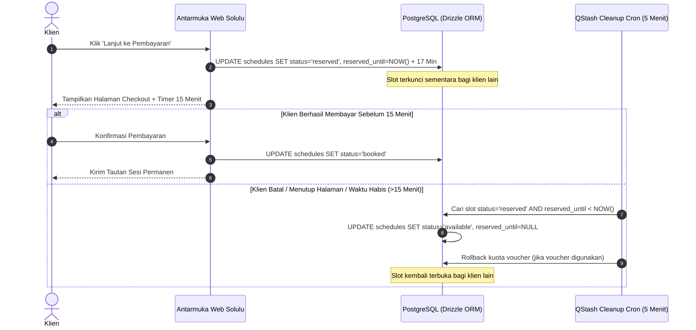

# Modul 01: Alur Pemesanan & Penjadwalan Konseling (Guest Flow)

> **Dokumen Spesifikasi Alur Pemesanan, Skrining Klinis SRQ-20 & Penjadwalan 7 Slot Harian**  
> Bagian dari: **Dokumen Master Solulu (alur-booking-dan-jobdesk)**  
> Klasifikasi: **Panduan Alur Tamu, Operasional & Standar Layanan Klien**

---

## 1. Filosofi Guest-First & Privasi Rekam Medis

Salah satu hambatan terbesar seseorang dalam mencari bantuan kesehatan mental adalah rasa takut akan kebocoran data, birokrasi pendaftaran akun yang rumit, dan stigma sosial. 

Solulu menyelesaikan masalah ini melalui arsitektur **Guest-First Checkout**:
* **Tanpa Registrasi Akun:** Calon klien tidak perlu membuat username atau mengingat kata sandi. Reservasi dilakukan langsung selayaknya tamu (*guest*).
* **Token Akses Rahasia Unik:** Setiap pesanan terkonfirmasi menghasilkan *access token* unik sepanjang 32 karakter acak kriptografis (`nanoid(32)`). Tautan ini menjadi pintu masuk eksklusif ke **Halaman Sesi Mandiri** di `/session/[token]`.
* **Pengelompokan Riwayat Otomatis:** Meskipun klien tidak memiliki akun login, sistem Solulu secara otomatis mengenali dan menautkan riwayat sesi terdahulu klien berdasarkan kombinasi **Nomor WhatsApp & Alamat Email**. Ketika klien berkonsultasi kembali, konselor pendamping dapat langsung meninjau riwayat perkembangan sesi sebelumnya secara berkesinambungan.

---

## 2. Aturan 7 Slot Waktu Harian Tetap (08.00 – 22.00 WIB)

Untuk menjaga sinkronisasi ruang telekonferensi Zoom Pro dan memastikan stabilitas operasional operator, jadwal konseling di Solulu **tidak ditentukan bebas secara sembarang**, melainkan dibagi ke dalam **7 Slot Tetap Harian** berdurasi 2 jam (zona waktu Indonesia Barat / WIB):

```mermaid
gantt
    title Distribusi 7 Slot Waktu Harian Solulu (WIB)
    dateFormat HH:mm
    axisFormat %H:%M
    section Slot Pagi
    Slot 1 (08.00 - 10.00 WIB) : 08:00, 2h
    Slot 2 (10.00 - 12.00 WIB) : 10:00, 2h
    section Slot Siang & Sore
    Slot 3 (12.00 - 14.00 WIB) : 12:00, 2h
    Slot 4 (14.00 - 16.00 WIB) : 14:00, 2h
    Slot 5 (16.00 - 18.00 WIB) : 16:00, 2h
    section Slot Malam
    Slot 6 (18.00 - 20.00 WIB) : 18:00, 2h
    Slot 7 (20.00 - 22.00 WIB) : 20:00, 2h
```

### Rincian Jadwal & Waktu Efektif Sesi

| Slot | Rentang Jam (WIB) | Waktu Konsultasi Efektif | Toleransi & Buffer Istirahat |
| :--- | :--- | :--- | :--- |
| **Slot 1** | `08.00 – 10.00 WIB` | 90 Menit (08.00 – 09.30) | 30 Menit (Opsi perpanjangan s/d 10.00 WIB / jeda konselor) |
| **Slot 2** | `10.00 – 12.00 WIB` | 90 Menit (10.00 – 11.30) | 30 Menit (Opsi perpanjangan s/d 12.00 WIB / jeda konselor) |
| **Slot 3** | `12.00 – 14.00 WIB` | 90 Menit (12.00 – 13.30) | 30 Menit (Opsi perpanjangan s/d 14.00 WIB / jeda konselor) |
| **Slot 4** | `14.00 – 16.00 WIB` | 90 Menit (14.00 – 15.30) | 30 Menit (Opsi perpanjangan s/d 16.00 WIB / jeda konselor) |
| **Slot 5** | `16.00 – 18.00 WIB` | 90 Menit (16.00 – 17.30) | 30 Menit (Opsi perpanjangan s/d 18.00 WIB / jeda konselor) |
| **Slot 6** | `18.00 – 20.00 WIB` | 90 Menit (18.00 – 19.30) | 30 Menit (Opsi perpanjangan s/d 20.00 WIB / jeda konselor) |
| **Slot 7** | `20.00 – 22.00 WIB` | 90 Menit (20.00 – 21.30) | 30 Menit (Opsi perpanjangan s/d 22.00 WIB / penutupan harian) |

> [!NOTE]
> **Mengapa Berdurasi 2 Jam untuk Sesi 90 Menit?**  
> Sesi konseling standar berlangsung selama 90 menit penuh. Alokasi 120 menit (2 jam) memberikan bantalan waktu 30 menit yang berfungsi ganda:
> 1. Memberikan ruang bagi fitur **Perpanjangan Sesi Berjalan (*Extend Session*)** apabila klien dan konselor membutuhkan waktu tambahan.
> 2. Memberikan jeda istirahat (*mindfulness buffer*) bagi konselor sebelum menangani klien pada slot berikutnya.

---

## 3. Kuota Maksimal Slot & Aturan Cutoff H-4 Jam

Sistem menerapkan dua pengaman kapasitas (*guardrails*) untuk mencegah kekacauan jadwal:

1. **Kuota Maksimal Slot (Default: 10 Sesi Bersamaan):**  
   Setiap slot harian dibatasi maksimal **10 sesi konseling paralel**. Batasan ini diselaraskan secara presisi dengan kapasitas arsitektur **4 Akun Zoom Pro Klinik** (3 sesi mandiri + 7 sesi gabungan di Breakout Room Akun 4).
2. **Batas Waktu Pemesanan (*Cutoff H-4 Jam*):**  
   Reservasi baru dan pengajuan ubah jadwal mandiri oleh klien otomatis ditutup **4 jam sebelum jam mulai slot**.  
   * *Contoh:* Untuk sesi Slot 6 (`18.00 WIB`), pemesanan dan perubahan jadwal mandiri ditutup tepat pada pukul `14.00 WIB`.  
   * **Manfaat Bisnis:** Memberikan kepastian beban kerja kepada konselor dan memungkinkan Operator Zoom menentukan mode ruangan (apakah slot tersebut berjalan mandiri atau membutuhkan pemanduan Breakout Room) sejak H-4 jam.

---

## 4. Pengumpulan Data Klien (8 Data Wajib & Informed Consent)

Saat klien melakukan reservasi, formulir mengumpulkan **8 data primer** yang esensial bagi kesiapan penanganan konseling:

| No | Data Klien | Fungsi & Kebutuhan Klinis | Aturan Privasi |
| :---: | :--- | :--- | :--- |
| **1** | **Nama Lengkap / Panggilan** | Identifikasi klien di ruang Zoom & sapaan konselor. | Ditampilkan sebagai inisial pada testimoni publik. |
| **2** | **Alamat Email** | Pengiriman surat elektronik berisi Tautan Sesi & tanda terima pembayaran. | Dijamin tidak disebarluaskan untuk spam promosi. |
| **3** | **Nomor WhatsApp** | Kanal verifikasi pembukaan laporan sesi & kontak darurat operator. | Disimpan terenkripsi, dipakai untuk *matching* riwayat. |
| **4** | **Jenis Kelamin** | Penyesuaian pendekatan emosional & pemetaan psikososial. | Tertutup hanya untuk Konselor pendamping. |
| **5** | **Umur** | Penilaian tahap perkembangan psikologis & legalitas persetujuan. | Tertutup hanya untuk Konselor pendamping. |
| **6** | **Domisili (Kota/Provinsi)** | Konteks lingkungan sosial-budaya dan rujukan darurat lokal jika krisis. | Tertutup hanya untuk Konselor pendamping. |
| **7** | **Agama / Kepercayaan** | Pertimbangan nilai spiritual dalam konseling (jika relevan bagi klien). | Tertutup hanya untuk Konselor pendamping. |
| **8** | **Catatan / Keluhan Awal** | Uraian masalah utama atau harapan klien sebelum sesi dimulai. | **Hanya dapat dibaca oleh Konselor**, tersembunyi dari Admin & Operator. |

### Persetujuan Layanan (*Informed Consent*)
Di bagian bawah formulir, klien wajib mencentang persetujuan *Informed Consent* yang memuat:
* Persetujuan mengikuti konseling telekonsultasi secara sadar dan sukarela.
* Pemahaman bahwa layanan Solulu bukan pengganti penanganan kegawatdaruratan medis/psikiatri darurat rumah sakit.
* Izin dokumentasi bukti kehadiran internal (tangkapan layar wajah tertutup/rahasia) semata-mata untuk verifikasi operasional dan pencairan komisi mitra.

---

## 5. Skrining Mandiri Klinis SRQ-20 (WHO Standard)

Sebelum atau bersamaan dengan pemesanan, calon klien diarahkan mengikuti kuesioner **Self-Reporting Questionnaire (SRQ-20)** standar Badan Kesehatan Dunia (WHO). Kuesioner ini terdiri dari **20 pertanyaan ya/tidak** seputar gejala somatik, kecemasan, dan depresi yang dialami dalam 30 hari terakhir.

### Logika Triage & Rekomendasi Mitra
1. **Pikiran Mengakhiri Hidup (Pertanyaan 17 = 'Ya'):**  
   Sistem menandai flag `hasSuicidalThoughts = true`. Klien sangat direkomendasikan memilih **Psikolog Klinis**.
2. **Skor Total ≥ 6:**  
   Menandakan indikasi distres neurotik/psikologis yang memerlukan penanganan terapis berizin resmi (**Psikolog Klinis**).
3. **Skor Total < 6:**  
   Kategori distres ringan hingga sedang yang sangat tepat didampingi oleh **Mitra Konselor Sebaya**.
4. **Emergency Waiver (Bypass Rekomendasi):**  
   Jika klien berisiko tinggi tetap bersikeras memilih Konselor Sebaya karena faktor biaya, sistem mewajibkan persetujuan klausul *Emergency Waiver* agar konselor mengetahui kondisi klien secara transparan dan berhak melakukan eskalasi rujukan jika diperlukan.

---

## 6. Kunci Jadwal Sementara (*Slot Hold 15 Menit*)

Untuk mencegah bentrok reservasi (*double booking*) di mana dua klien memesan slot konselor yang sama di detik yang bersamaan, sistem menerapkan mekanisme penguncian atomik:

* **Durasi Timer Klien:** 15 Menit di layar.
* **Durasi Database (`reserved_until`):** 17 Menit (memberikan buffer 2 menit untuk mengantisipasi jeda jaringan dan latensi webhook payment gateway agar tidak terjadi pembatalan saat uang klien sudah terpotong).

---

## 7. Panduan Langkah demi Langkah Pemesanan Klien (Visual)

### Langkah 1: Memilih Mitra Konselor di Katalog
Klien membuka halaman katalog `/counselors`, memfilter berdasarkan jenis mitra (Konselor Sebaya atau Psikolog Klinis), melihat bio serta jadwal yang tersedia, lalu menekan tombol **"Pilih Jadwal"**.

---

### Langkah 2: Mengisi Skrining SRQ-20
Klien menjawab 20 pertanyaan mandiri untuk mendapatkan gambaran kondisi emosional dan rekomendasi profesional pendamping.

---

### Langkah 3: Melengkapi 8 Data Klien & Persetujuan
Klien mengisi data kontak (WhatsApp dan Email aktif sangat krusial untuk pengiriman link sesi), menuliskan keluhan awal secara privat, mencentang *Informed Consent*, lalu memilih metode pembayaran.

---

### Langkah 4: Menerima Tautan Sesi Permanen & Pemulihan Akses
Setelah pembayaran diverifikasi lunas, klien langsung menerima email konfirmasi. Jika klien lupa menyimpan tautan sesi atau tidak sengaja menutup peramban, klien dapat memulihkan tautan sesi kapan saja melalui menu `/cek-sesi` hanya dengan mengetikkan Nomor WhatsApp terdaftar.

---
*Langkah selanjutnya mengenai proses pembayaran otomatis, manual, dan verifikasi admin dijelaskan pada [Modul 02: Metode Pembayaran & Verifikasi](file:///home/muhalfatih/solulu-web/alur-booking-dan-jobdesk/02-metode-pembayaran-dan-verifikasi.md).*
