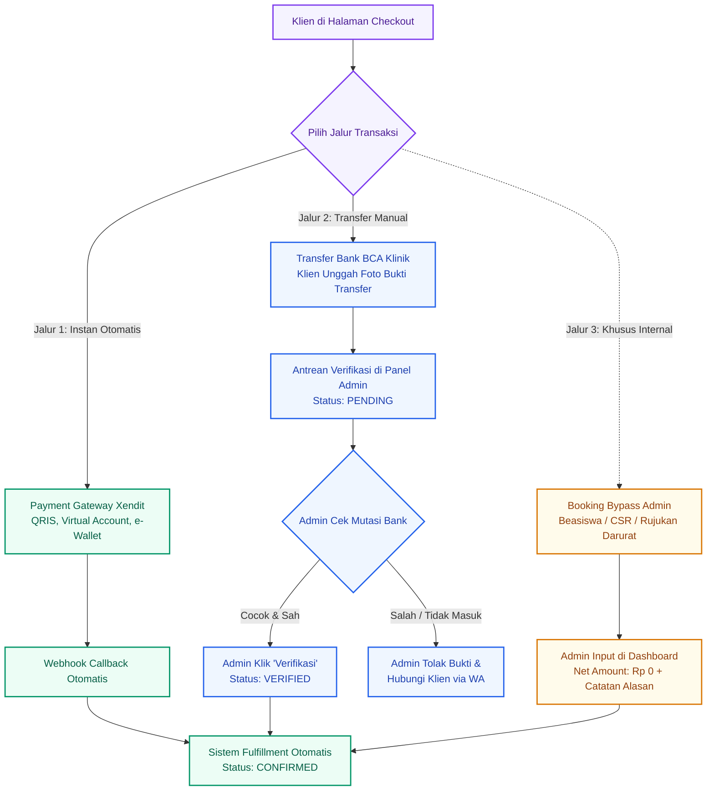
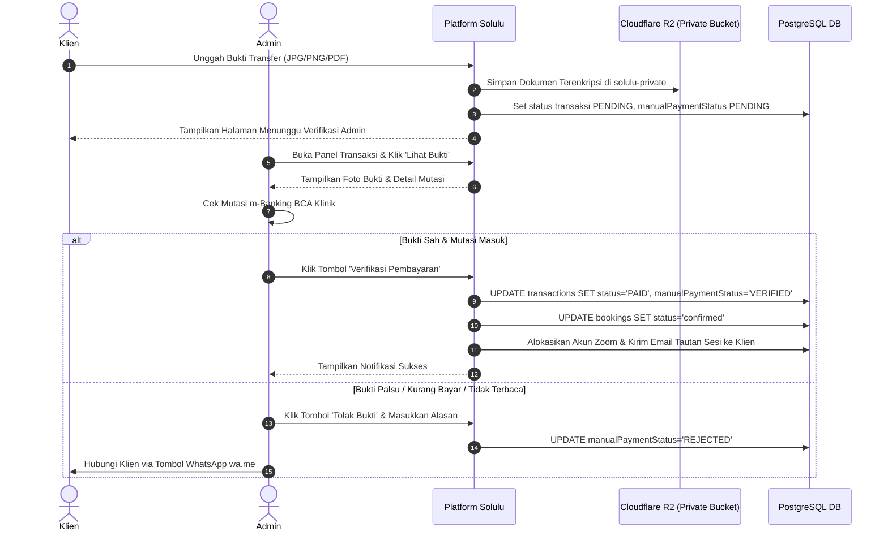
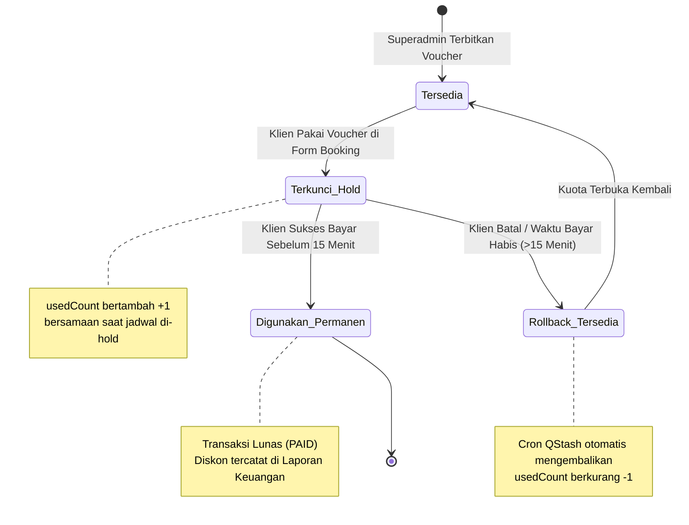

# Modul 02: Metode Pembayaran, Verifikasi Transaksi & Siklus Voucher

> **Dokumen Spesifikasi Gerbang Pembayaran, Verifikasi Admin, Bypass Rp0 & Rekapitulasi Komisi**  
> Bagian dari: **Dokumen Master Solulu (alur-booking-dan-jobdesk)**  
> Klasifikasi: **Panduan Keuangan, Administrasi & Transaksi Klien**

---

## 1. Tiga Model Pembayaran di Solulu

Untuk memberikan kenyamanan maksimal bagi klien dari berbagai latar belakang, Solulu menyediakan **3 jalur transaksi** yang terkelola rapi di dalam sistem:

---

## 2. Jalur 1: Pembayaran Instan Otomatis (Xendit Gateway)

Jalur pembayaran otomatis dirancang untuk konfirmasi instan tanpa campur tangan manusia.

* **Kanal Pembayaran Tersedia:**
  * **QRIS Real-Time:** Mendukung semua aplikasi e-Wallet (GoPay, OVO, Dana, ShopeePay, LinkAja) dan Mobile Banking berlogo QRIS.
  * **Virtual Account (VA):** BCA, Mandiri, BNI, BRI, Permata Bank (nomor VA unik per pesanan).
  * **Kartu Kredit / Debit:** Visa, MasterCard, JCB dengan autentikasi 3D Secure.
* **Masa Berlaku Invoice:** Tepat **15 Menit** sejak dibuat.
* **Mekanisme Eksekusi (Webhook & QStash Worker):**  
  Ketika pembayaran terdeteksi lunas oleh Xendit:
  1. Xendit mengirimkan sinyal *HTTP Webhook Callback* ke `/api/webhooks/xendit`.
  2. Webhook segera merespons status `200 OK` dan mendelegasikan tugas pemenuhan (*session fulfillment*) ke antrean pesan **Upstash QStash** untuk mencegah kendala batas waktu koneksi (*timeout*).
  3. Pekerja (*worker*) QStash mengubah status pesanan menjadi `confirmed`, mengunci slot jadwal menjadi `booked`, mengalokasikan akun Zoom Pro klinik, dan menerbitkan email tanda terima serta tautan sesi mandiri ke klien.

---

## 3. Jalur 2: Transfer Bank Manual ke Rekening Klinik

Bagi klien yang mengalami kendala transaksi digital atau lebih memilih transfer langsung antar-bank:

### A. Prosedur Pembayaran Klien
1. Pada halaman checkout, klien memilih opsi **"Transfer Bank Manual"**.
2. Sistem menampilkan nomor rekening resmi klinik:
   * **Bank:** BCA (Bank Central Asia)
   * **Nomor Rekening:** `123-456-7890` (atau sesuai konfigurasi Admin)
   * **Atas Nama:** Solulu Mental Health Indonesia
   * **Berita Transfer:** Wajib mencantumkan **Kode Booking** (contoh: `SL-4821`).
3. Klien mentransfer nominal tepat, lalu mengambil tangkapan layar / foto struk transfer.
4. Klien mengunggah file bukti transfer pada form web, lalu menekan **"Kirim Bukti Pembayaran"**.

### B. Prosedur Verifikasi oleh Tim Admin
Tangkapan layar bukti transfer masuk ke antrean verifikasi Admin di `/admin/transactions`:

> [!IMPORTANT]
> **SOP Keamanan Verifikasi Admin:**
> * Admin **wajib mencocokkan** mutasi rekening koran nyata di m-Banking klinik, bukan hanya mengandalkan keaslian visual foto struk.
> * Verifikasi manual harus diproses dalam waktu maksimal **30 menit** pada jam operasional agar tidak melewati batas waktu persiapan sesi.

---

## 4. Jalur 3: Booking Manual / Bypass Admin (Net Rp 0)

Dalam situasi kemanusiaan atau operasional darurat tertentu, Admin memiliki wewenang membuat pesanan konseling langsung tanpa pembayaran (*Admin Bypass*):

### Kondisi yang Memenuhi Syarat Bypass:
1. **Beasiswa Kesehatan Mental:** Klien terpilih dalam program beasiswa atau subsidi yayasan mitra.
2. **Krisis & Rujukan Khusus:** Kasus kedaruratan emosional rujukan rumah sakit atau konselor senior tanpa pungutan biaya (*pro-bono*).
3. **Penjadwalan Pengganti Darurat:** Kompensasi atas gangguan teknis sistem sebelumnya yang membutuhkan pembuatan sesi pengganti.

### Mekanisme Sistem Bypass:
* Admin membuka menu `/admin/bookings/new` dan memilih opsi **"Bypass Pembayaran (Rp 0)"**.
* Transaksi dicatat resmi di database dengan nilai bersih `netAmount: 0` dan `status: PAID`.
* Admin **wajib menginput Catatan Alasan Bypass** (contoh: *"Rujukan Beasiswa Mahasiswa Batch 3"* atau *"Kompensasi Gangguan Zoom Slot 2"*) untuk keperluan audit laporan keuangan internal.
* Pasca-pembuatan, sesi langsung didelegasikan ke modul *Session Fulfillment* sehingga alokasi Zoom dan pengiriman email link sesi berjalan otomatis sama persis seperti pesanan berbayar.

---

## 5. Siklus Hidup Voucher Diskon & Proteksi Kuota

Solulu mendukung penggunaan kode promo dan voucher diskon (potongan harga nominal tetap maupun persentase). Untuk mencegah manipulasi kuota dan *race conditions*, siklus hidup voucher diatur secara atomik:

### Tabel Perbandingan Perhitungan Diskon Voucher

| Tipe Diskon | Nilai Pengaturan | Biaya Asli | Diskon Terpotong | Biaya Bersih (*Net*) |
| :--- | :---: | :---: | :---: | :---: |
| **Nominal Tetap (*Fixed*)** | `Rp 50.000` | Rp 150.000 | - Rp 50.000 | **Rp 100.000** |
| **Persentase (*Percentage*)** | `20%` | Rp 150.000 | - Rp 30.000 | **Rp 120.000** |
| **Gratis Penuh (*100% Promo*)** | `100%` | Rp 150.000 | - Rp 150.000 | **Rp 0** |

---

## 6. Rekapitulasi Pembayaran & Audit Komisi Konselor

Sistem Solulu mengadopsi prinsip **Decoupled Payroll Architecture**:
* Sistem menyajikan data audit transaksi dan durasi konsultasi secara transparan.
* Perhitungan komisi konselor disajikan siap ekspor pada menu **Laporan Pembayaran & Komisi** (`/admin/payouts`).
* Komisi mitra konselor baru berstatus **"Siap Dicairkan (*Eligible for Payout*)"** apabila konselor telah menuntaskan kewajiban administratif, yaitu **mengisi Laporan Sesi Klinis dan mengunggah foto bukti kehadiran**.

### Matriks Status Transaksi & Dampak Operasional

| Status Transaksi | Status Jadwal | Tautan Sesi Klien | Hak Komisi Konselor | Tindakan Lanjutan |
| :--- | :--- | :--- | :--- | :--- |
| `PENDING` | `reserved` | Belum Aktif | Belum Ada | Menunggu pembayaran / verifikasi struk admin. |
| `PAID` | `booked` | Aktif Permanen | Menunggu Sesi Selesai | Ruang Zoom dialokasikan, sesi siap dijalankan. |
| `EXPIRED` | `available` | Batal / Hangus | Tidak Ada | Waktu bayar habis, slot dilepas kembali. |
| `FAILED` | `available` | Batal / Hangus | Tidak Ada | Transaksi gateway gagal, slot dilepas kembali. |

---

## 7. Tampilan Antarmuka Panel Verifikasi Pembayaran Admin

Berikut adalah tampilan nyata menu verifikasi pembayaran dan administrasi konselor di panel Admin Solulu:

### Antarmuka Verifikasi Data & Pengaturan Tarif Mitra
Admin dapat memeriksa keaslian data, mengatur tarif dasar, serta memantau histori transaksi setiap konselor:

---
*Langkah berikutnya mengenai penanganan situasi darurat, pembatalan, dan toleransi keterlambatan dijelaskan pada [Modul 03: Kondisi Khusus, Pembatalan & Kehadiran](file:///home/muhalfatih/solulu-web/alur-booking-dan-jobdesk/03-kondisi-khusus-pembatalan-dan-kehadiran.md).*
