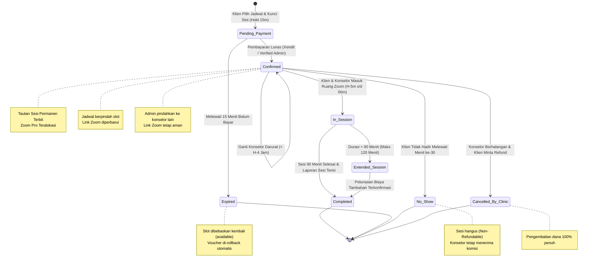
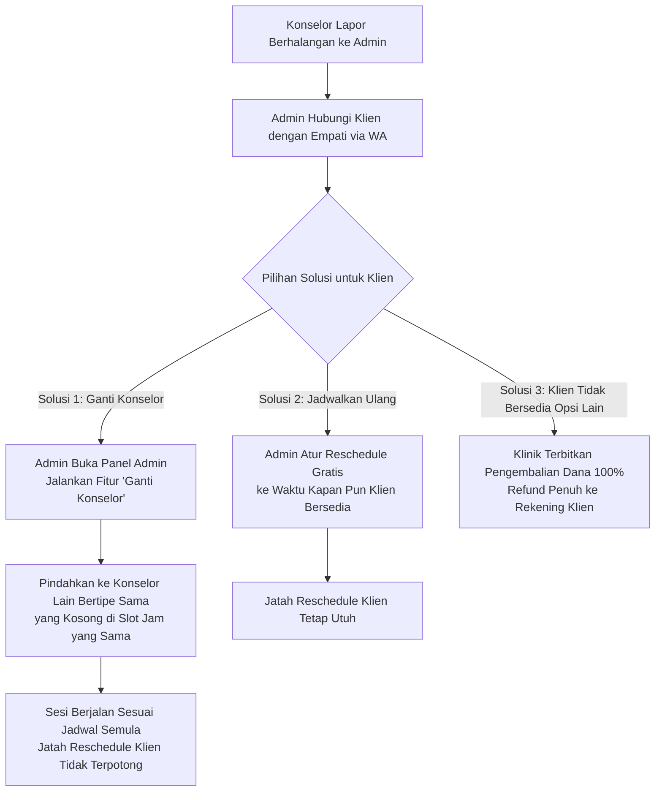
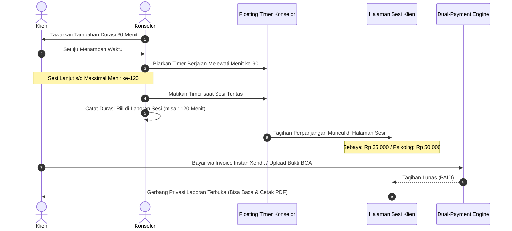

# Modul 03: Skenario Kondisi Khusus, Pembatalan, Reschedule & Kehadiran

> **Dokumen Spesifikasi Mitigasi Risiko, Kebijakan Pembatalan, Reschedule, No-Show & Perpanjangan Sesi**  
> Bagian dari: **Dokumen Master Solulu (alur-booking-dan-jobdesk)**  
> Klasifikasi: **Panduan Kebijakan Layanan, SLA Operasional & Kepuasan Klien**

---

## 1. Diagram State Machine Siklus Hidup Sesi Konseling

Sistem mengelola seluruh dinamika status pesanan (*booking lifecycle*) melalui mesin status terpadu berikut:

---

## 2. Skenario 1: Batas Waktu Bayar Habis (*Slot Hold Expired*)

### Kondisi
Klien telah memilih konselor dan mengisi formulir, namun tidak menyelesaikan pembayaran dalam jangka waktu **15 Menit**.

### Penanganan Sistem Otomatis
1. **Cron Job QStash Berkala (Setiap 5 Menit):**  
   Pekerja sistem `/api/cron/cleanup-slots` memindai tabel `schedules` untuk menemukan slot dengan status `reserved` yang waktu `reserved_until`-nya telah lampau (`< NOW()`).
2. **Pembebasan Jadwal:**  
   Status slot jadwal otomatis diubah kembali menjadi `available` sehingga calon klien lain dapat langsung memesannya.
3. **Rollback Voucher Otomatis:**  
   Jika pesanan yang kedaluwarsa menggunakan voucher promo, kuota terpakai (`usedCount`) pada tabel `vouchers` otomatis dikurangi (-1) secara atomik, menjaga hak kuota voucher agar tidak hangus sia-sia.
4. **Respon pada Klien:**  
   Jika klien mencoba membayar setelah 15 menit lewat, invoice Xendit menampilkan status *Expired* dan mengarahkan klien untuk memilih ulang jadwal yang masih tersedia.

---

## 3. Skenario 2: Pembatalan Sepihak oleh Klien (*Cancellation*)

### Kebijakan Layanan (*Non-Refundable Policy*)
Sebagai komitmen profesional terhadap waktu kerja mitra konselor:
* Pembatalan sepihak oleh klien pada pesanan yang telah berstatus `confirmed` bersifat **Tidak Dapat Dikembalikan (*Non-Refundable*)**, khususnya jika diajukan di bawah batas H-4 jam atau pada waktu sesi berjalan.
* **Alasan Kebijakan:** Mitra konselor telah mengosongkan agenda selama 2 jam penuh dan sistem telah menolak calon klien lain untuk slot tersebut.

### Solusi Ramah Klien: Reschedule Gratis
Klien yang berhalangan tidak kehilangan hak sesinya, melainkan diarahkan menggunakan hak **Ubah Jadwal (*Reschedule*)** paling lambat **H-4 jam** sebelum sesi dimulai.

---

## 4. Skenario 3: Pengajuan Ubah Jadwal (*Reschedule*)

Klien memiliki hak mengubah jadwal sesi dengan ketentuan baku:
* **Kuota Maksimal:** **1 Kali** per nomor pesanan (*booking code*).
* **Batas Waktu (*Cutoff*):** Paling lambat **4 Jam sebelum sesi dimulai (H-4 Jam)**.

### Jalur 1: Reschedule Mandiri (Langsung di Halaman Sesi Klien)
1. Klien membuka tautan sesi mandirinya di `/session/[token]`.
2. Jika waktu saat ini masih lebih dari 4 jam sebelum sesi dan kuota ubah jadwal belum terpakai (`reschedule_count = 0`), tombol **"Ajukan Ubah Jadwal"** akan aktif.
3. Klien memilih tanggal dan slot baru yang berstatus `available` pada konselor yang sama.
4. Sistem memindahkan jadwal secara instan: slot lama dilepas kembali menjadi `available`, slot baru dikunci menjadi `booked`, dan nilai `reschedule_count` tercatat menjadi `1`.
5. Tautan Zoom dan rincian waktu baru otomatis terbarukan tanpa perlu bantuan admin.

### Jalur 2: Reschedule Dibantu Admin (via WhatsApp)
Jika waktu tersisa mendekati batas cutoff atau klien mengalami kesulitan teknis:
1. Klien menekan tombol **"Bantuan Reschedule via WhatsApp"** di halaman sesi.
2. Pesan terformat otomatis terkirim ke WhatsApp Admin Solulu.
3. Admin memverifikasi ketersediaan jadwal alternatif konselor di panel admin, lalu mengeksekusi pemindahan slot jadwal melalui menu dropdown di `/admin/bookings`.

---

## 5. Skenario 4: Konselor Berhalangan Mendadak (< H-4 Jam)

Apabila terjadi kondisi darurat di mana mitra konselor mendadak sakit keras, mengalami kecelakaan, atau kendala jaringan/listrik padam di bawah H-4 jam:

> [!TIP]
> **Jaminan Kepuasan Klien:**  
> Dalam kondisi kendala yang bersumber dari pihak konselor atau klinik, kuota ubah jadwal klien **tidak pernah dipotong** (`reschedule_count` tetap 0), dan klien berhak memilih ganti konselor setara atau refund penuh jika jadwal alternatif tidak sesuai.

---

## 6. Skenario 5: Klien Tidak Hadir (*No-Show* > 30 Menit)

### Batas Toleransi Ruang Tunggu (30 Menit)
* Ruang Zoom telah dibuka 5–10 menit sebelum jam sesi dimulai.
* Konselor bersiaga di ruang konseling sejak menit 00.
* Jika hingga menit ke-15 klien belum bergabung, Operator/Admin mengirimkan pesan WhatsApp pengingat ramah:  
  * *"Halo Kak [Nama], sesi konseling Anda bersama Kak [Konselor] telah dimulai di tautan Zoom berikut. Kami siap menunggu kehadiran Kakak di ruang sesi."*

### Prosedur Penetapan Status No-Show
1. Jika hingga **menit ke-30** klien tidak hadir dan tidak memberikan konfirmasi melalui WhatsApp, toleransi kehadiran resmi berakhir.
2. Konselor menekan tombol **"Tandai Sesi Selesai (Klien Tidak Hadir / No-Show)"** di dashboard konselor.
3. Sistem memperbarui data:
   * Status pesanan berubah menjadi `completed`.
   * Flag `isNoShow = true` dan waktu `noShowMarkedAt = NOW()` tercatat untuk audit.
4. **Ketentuan Finansial:**  
   * Biaya sesi hangus (*Non-Refundable*).
   * **Mitra konselor tetap berhak menerima komisi penuh 100%** atas slot tersebut sebagai kompensasi atas kesiagaan waktu profesional konselor.

---

## 7. Skenario 6: Perpanjangan Sesi Berjalan (*Extend Session* > 90 Menit)

Standar waktu konseling adalah 90 menit efektif, dengan batas toleransi penyelesaian kesimpulan (*grace period*) selama 5 menit (hingga menit ke-95).

Apabila klien berada dalam dinamika emosional intens yang memerlukan penanganan lanjutan dan kedua belah pihak sepakat menambah durasi:

### Ketentuan Tarif Perpanjangan Sesi (Flat per 30 Menit)
* **Konselor Sebaya:** `Rp 35.000` per blok 30 menit.
* **Psikolog Klinis:** `Rp 50.000` per blok 30 menit.
* **Batas Maksimal:** Maksimal penambahan adalah 1 blok (30 menit), sehingga total durasi sesi tidak boleh melampaui 120 menit (2 jam) agar tidak mengorbankan slot berikutnya.

---

## 8. Skenario 7: Klien Kehilangan Tautan Sesi (*Session Recovery*)

Jika klien tidak sengaja menghapus email konfirmasi, kehilangan riwayat chat WhatsApp, atau berganti perangkat gawai:

1. Klien membuka halaman publik `/cek-sesi`.
2. Klien memasukkan **Nomor WhatsApp** atau **Alamat Email** yang digunakan saat mendaftar.
3. Sistem secara otomatis mencocokkan nomor/email tersebut, lalu menampilkan daftar seluruh sesi aktif mendatang beserta tautan langsung ke Halaman Sesi Mandiri klien tanpa memerlukan login password.

---

## 9. Tampilan Antarmuka Halaman Sesi Mandiri Klien

Berikut adalah tangkapan layar Halaman Sesi Mandiri klien yang memuat seluruh kartu kontrol (Countdown, Reschedule, Banner Nama Zoom, dan Akses Laporan):

### Antarmuka Sesi Terkonfirmasi & Tombol Reschedule Mandiri
Klien dapat melihat hitung mundur, aturan nama tampilan Zoom, tautan Zoom aktif, dan mengajukan ubah jadwal mandiri:

### Antarmuka Sesi Selesai & Pelindung Privasi Laporan
Pasca-sesi, klien memasukkan nomor WhatsApp untuk membuka laporan hasil konseling dan mengunduh berkas PDF ringkasan sesi:

---
*Langkah berikutnya mengenai arsitektur teknis 4 akun Zoom Pro dan pemanduan Breakout Room oleh Operator dijelaskan pada [Modul 04: SOP Teknis Zoom & Room Dispatcher](file:///home/muhalfatih/solulu-web/alur-booking-dan-jobdesk/04-sop-teknis-zoom-dan-room-dispatcher.md).*
