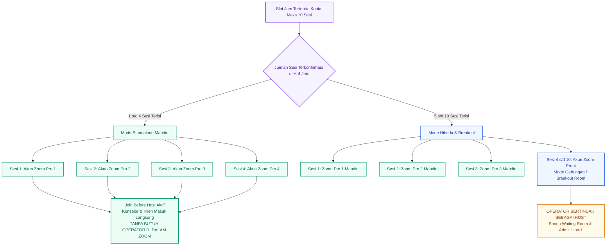

# Modul 04: SOP Teknis Ruang Zoom & Dispatcher 4 Akun Pro

> **Dokumen Spesifikasi Arsitektur Telekonferensi, Alokasi Ruang Cerdas & SOP Pemanduan Breakout Room**  
> Bagian dari: **Dokumen Master Solulu (alur-booking-dan-jobdesk)**  
> Klasifikasi: **SOP Teknis, Operasional Operator & Panduan Privasi Ruangan**

---

## 1. Arsitektur 4 Akun Zoom Pro Klinik

Platform Solulu mengimplementasikan arsitektur **Zoom Pro Dispatcher** cerdas untuk menghasilkan ruang konseling yang sepenuhnya privat, bebas batas waktu 40 menit, dan efisien dari segi biaya operasional klinik:

### Tabel Alokasi 4 Akun Zoom Berdasarkan Urutan Pesanan

| Urutan Pesanan pada Slot Sama | Akun Zoom Dialokasikan | Mode Ruangan | Keterlibatan Operator di Ruang Zoom |
| :--- | :--- | :--- | :--- |
| **Pesanan Ke-1** | Akun Zoom Pro 1 | Standalone (1-on-1 Mandiri) | **Tidak Ada** (*Join Before Host* aktif) |
| **Pesanan Ke-2** | Akun Zoom Pro 2 | Standalone (1-on-1 Mandiri) | **Tidak Ada** (*Join Before Host* aktif) |
| **Pesanan Ke-3** | Akun Zoom Pro 3 | Standalone (1-on-1 Mandiri) | **Tidak Ada** (*Join Before Host* aktif) |
| **Pesanan Ke-4** *(Jika total slot ≤ 4)* | Akun Zoom Pro 4 | Standalone (1-on-1 Mandiri) | **Tidak Ada** (*Join Before Host* aktif) |
| **Pesanan Ke-4 s/d Ke-10** *(Jika total > 4)* | Akun Zoom Pro 4 | **Breakout Room Gabungan** | **Wajib Dipandu Operator** (*Host / Navigator*) |

> [!NOTE]
> **Tautan Zoom Permanen & Statis:**  
> Tautan Zoom yang diterima klien di email dan halaman sesi bersifat statis dan **tidak pernah berubah** sejak pesanan terkonfirmasi. Sistem secara otomatis memetakan apakah link tersebut langsung membuka sesi privat mandiri atau masuk ke antrean ruang tunggu Zoom 4.

---

## 2. Mengapa Matriks Terkunci di Batas Waktu H-4 Jam?

Batas waktu pemesanan (*cutoff*) pada **H-4 Jam** sebelum jam sesi dimulai adalah poros utama stabilitas teknis:
1. **Kepastian Total Sesi:** Setelah H-4 jam lewat, tidak ada lagi pesanan baru maupun ubah jadwal mandiri yang dapat masuk.
2. **Pemetaan Beban Operator:**  
   Operator membuka **Konsol Operator** di `/operator` tepat setelah H-4 jam untuk melihat status slot mendatang:
   * Jika slot hanya berisi **1 s/d 4 sesi**: Operator mendapatkan kepastian bahwa **tidak ada tugas pemanduan Breakout** di Zoom 4 pada slot tersebut (hanya bersiaga via WhatsApp).
   * Jika slot berisi **5 s/d 10 sesi**: Operator segera bersiap untuk masuk ke Akun Zoom 4 pada H-15 menit untuk memandu alur Breakout Room.

---

## 3. SOP Alur Private Zoom Standalone (Sesi 1–3 atau 1–4)

Pada slot yang berjalan mandiri, ruang konseling beroperasi secara otonom tanpa memerlukan kehadiran staf operator di dalam pertemuan.

### Spesifikasi Teknis:
1. **Opsi *Join Before Host* Selalu Aktif:**  
   Meskipun konselor dan klien masuk menggunakan akun Zoom gratisan biasa (*Zoom Basic*), ruang rapat tidak akan meminta izin host untuk dimulai. Klien dan konselor dapat langsung saling bertatap muka dan berbicara tanpa batas waktu 40 menit karena ruang dibuat di bawah lisensi Akun Zoom Pro milik klinik.
2. **6-Digit *Host Key* untuk Konselor:**  
   Jika konselor memerlukan kendali host penuh (misalnya untuk membagikan layar materi intervensi / *Screen Sharing*), konselor dapat melihat **6 angka Host Key** pada dashboard konselor Solulu. Konselor cukup mengklik menu *Participants* di Zoom -> *Claim Host* -> masukkan 6 digit angka tersebut.

---

## 4. SOP Teknis Zoom 4 (Mode Breakout Room untuk Sesi 4–10)

Mode Breakout Room memungkinkan klinik melayani hingga 7 sesi konseling paralel secara simultan di dalam 1 akun Zoom Pro tanpa mengorbankan privasi klien.

### Jaminan Privasi Mutlak (*Zero-Exposure Rule*)
* **Ruang Tunggu (*Waiting Room*):** Peserta yang berada di dalam Waiting Room Zoom **secara teknis tidak dapat melihat daftar peserta lain** yang sedang mengantre.
* **Prosedur *Admit 1-on-1*:** Operator **DILARANG KERAS** memasukkan banyak klien sekaligus ke Ruang Utama (*Main Room*).  
  * Operator hanya mengizinkan **1 klien saja** masuk ke Main Room.
  * Dalam hitungan 5 detik, Operator langsung memindahkan (*Assign*) klien tersebut ke *Breakout Room* milik konselornya.
  * Setelah Main Room kembali kosong, Operator baru mengizinkan klien berikutnya masuk.  
  * **Hasil:** Antar-klien tidak pernah saling bertemu, tidak saling menyapa, dan tidak pernah melihat nama satu sama lain di layar Zoom.

---

## 5. Garis Waktu SOP Kerja Operator di Ruang Zoom 4

```mermaid
gantt
    title Garis Waktu Persiapan Operator Zoom 4 (Slot 5-10 Sesi)
    dateFormat mm
    axisFormat %M mnt
    section H-15 Menit
    Login Akun Zoom 4 sebagai Host : 00, 5m
    Aktifkan Waiting Room & Buat Kamar Breakout : 02, 3m
    section H-10 Menit
    Admit Seluruh Konselor ke Kamar Masing-masing : 05, 5m
    section H-5 Menit s/d Menit 00
    Verifikasi Nama Klien (Kode Booking) : 10, 5m
    Prosedur Admit 1-on-1 Klien ke Kamar : 11, 4m
    section Menit 00 - 120
    Sesi Konseling Berjalan di Breakout : 15, 45m
    Standby Penanganan Disconnect Klien : 15, 45m
```

### Tabel Rincian Langkah Kerja Operator

| Waktu Operasional | Peran Terlibat | Tindakan Teknis di Zoom 4 |
| :--- | :--- | :--- |
| **Tahap 1: Persiapan Ruang** *(H-15 Menit)* | **Operator** | 1. Buka aplikasi Zoom dan Login menggunakan kredensial Akun Zoom Pro 4 klinik. 2. Buka meeting slot berjalan. 3. Pastikan centang opsi **Enable Waiting Room** aktif. 4. Nonaktifkan opsi *"Allow participants to return to main session"*, agar klien tidak sengaja kembali ke ruang utama. 5. Buka panel *Breakout Rooms*, buat sejumlah kamar sesuai nama konselor (contoh: *"Room - Kak Dimas (SL-4821)"*). |
| **Tahap 2: Konselor Masuk** *(H-10 Menit)* | **Konselor & Operator** | 1. Konselor masuk ke tautan Zoom dari dashboard konselor. 2. Operator mengenali nama konselor di Waiting Room. 3. Operator langsung meng-admit dan memindahkan konselor ke kamar Breakout Room miliknya. 4. Konselor bersiap dan menguji mic/kamera di dalam kamar masing-masing. |
| **Tahap 3: Klien Masuk 1-on-1** *(H-5 Menit s/d Mulai)* | **Klien & Operator** | 1. Klien masuk dengan format nama: `[Kode Booking] - [Nama Panggilan]`. 2. Operator mencocokkan kode booking di konsol operator. 3. Operator menekan **Admit (1 Klien Saja)**. 4. Sapa singkat ramah: *"Selamat datang Kak, saya arahkan ke ruang konsultasi Kakak ya."* 5. Operator langsung meng-assign klien ke kamar konselornya. 6. Pastikan Main Room kosong, lalu ulangi untuk klien antrean berikutnya. |
| **Tahap 4: Pelaksanaan & Penutupan Sesi** *(Menit 00 – 120)* | **Konselor, Klien & Operator** | 1. Begitu klien tiba di Breakout Room, Konselor menyapa dan menyalakan **Floating Timer**. 2. Operator tetap bersiaga di Main Room jika ada peserta terputus koneksi. 3. Setelah konseling selesai, Klien dan Konselor menekan **Leave Meeting** langsung dari dalam Breakout Room tanpa kembali ke Main Room. |

---

## 6. Penanganan Masalah Lapangan (*Troubleshooting Matrix*)

| Kejadian di Lapangan | Indikasi Gejala | Prosedur Solusi Standar (SOP) |
| :--- | :--- | :--- |
| **Nama Tampilan Zoom Klien Tidak Standar** | Klien masuk ke Waiting Room dengan nama gawai (misal: *"iPhone"*, *"User-PC"*, atau nama anonim lain). | **DILARANG langsung memasukkan ke Main Room.** Operator menggunakan fitur **Chat to Waiting Room** (Direct Chat Host ke orang tersebut): *"Halo Kak, mohon sebutkan Kode Booking atau Nama Lengkap Anda agar kami dapat mengarahkan ke ruang konselor yang tepat."* Setelah klien menjawab kodenya, Operator mengubah nama tampilan klien (*Rename*) lalu meng-admit 1-on-1. |
| **Klien Terputus Sinyal (*Disconnect*)** | Klien mendadak keluar dari Breakout Room di tengah konseling karena koneksi internet mati/lemah. | Saat klien mengklik ulang tautan Zoom, klien otomatis tiba kembali di **Waiting Room Zoom 4**. Operator yang bersiaga di Main Room langsung mengenali nama klien dan **segera memindahkannya kembali ke Breakout Room konselornya**. |
| **Konselor Mengalami Kendala Perangkat** | Konselor belum masuk ke Zoom hingga H-5 menit. | Operator segera menghubungi nomor WhatsApp konselor untuk menanyakan situasi. Jika konselor membutuhkan waktu 5–10 menit untuk restart laptop, Operator mengirimkan pesan WhatsApp ke klien untuk menenangkan: *"Konselor Anda sedang menyiapkan perangkat ruang konsultasi, sesi akan segera dimulai beberapa saat lagi. Terima kasih atas kesabaran Kakak."* |
| **Klien Keliru Masuk ke Slot Waktu Lain** | Klien mencoba masuk ke Zoom 4 beberapa jam lebih awal atau di hari yang salah. | Operator memeriksa kode booking di konsol operator. Jika jadwalnya bukan di slot ini, Operator mengirim chat di Waiting Room: *"Halo Kak, jadwal konseling Anda tercatat pada pukul [Jam] WIB. Ruang sesi baru akan dibuka pada jam tersebut. Terima kasih."* lalu Operator dapat menolak/mengeluarkan dari antrean. |

---

## 7. Tampilan Antarmuka Konsol Operator & Pengaturan Jadwal

Berikut adalah tangkapan layar konsol monitoring yang digunakan oleh Operator dan Admin dalam memantau slot jadwal harian:

### Konsol Pengaturan & Monitoring Slot Jadwal Harian
Admin dan Operator dapat memantau keterisian setiap slot, status kehadiran konselor, serta rincian sesi terkonfirmasi:

---
*Langkah selanjutnya mengenai pembagian tugas terperinci bagi setiap peran dijelaskan pada [Modul 05: Tugas, Tanggung Jawab & Jobdesk 4 Peran](file:///home/muhalfatih/solulu-web/alur-booking-dan-jobdesk/05-tugas-dan-jobdesk-peran.md).*
