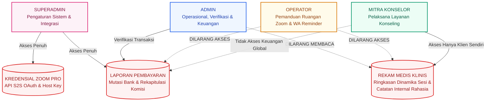
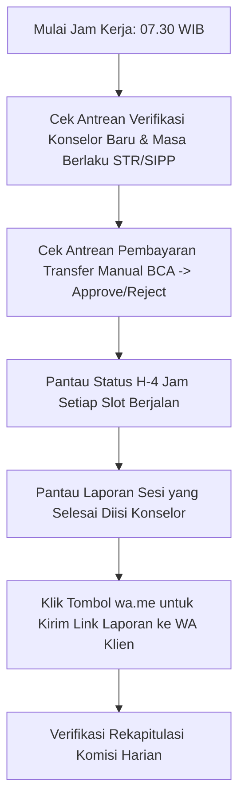
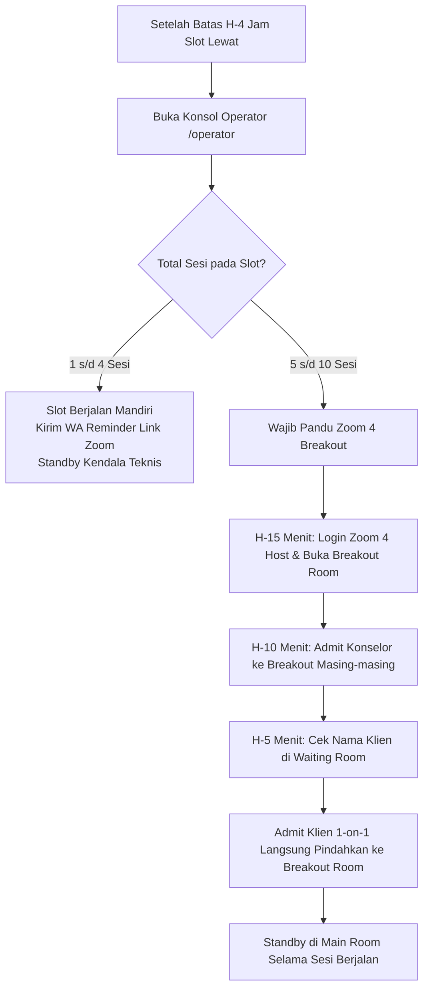
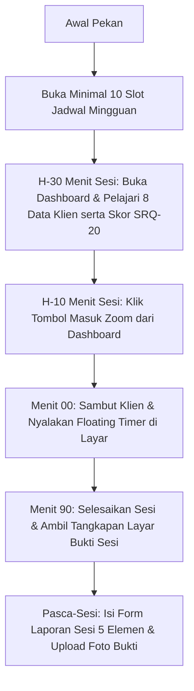

# Modul 05: Tugas, Tanggung Jawab & Jobdesk 4 Peran (RACI Matrix)

> **Dokumen Spesifikasi Pembagian Peran, Batasan Akses Privasi, Jobdesc & Checklist SOP Harian**  
> Bagian dari: **Dokumen Master Solulu (alur-booking-dan-jobdesk)**  
> Klasifikasi: **Standar Manajemen SDM, SOP Operasional & Pembagian Tanggung Jawab**

---

## 1. Prinsip Pemisahan Tugas & Batasan Privasi Medis (*Zero-Leak*)

Untuk melindungi kerahasiaan klien sekaligus memastikan efisiensi kerja tim klinik, sistem Solulu memberlakukan pemisahan hak akses (*Separation of Concerns*) berbasis peran (Role-Based Access Control / RBAC) yang sangat ketat:

### Batasan Hak Akses Baku:
* **Admin Operasional:** Memverifikasi pembayaran dan memantau status penyelesaian laporan konselor, namun **DILARANG KERAS dan dibatasi secara sistem untuk membaca isi teks klinis** (*Ringkasan Dinamika Sesi* maupun *Catatan Internal*). Admin hanya dapat melihat status laporan ("Sudah Diisi") dan foto bukti kehadiran untuk keperluan audit komisi.
* **Operator Teknis:** Mengelola ruang Zoom dan mengirimkan pesan pengingat WA, namun **TIDAK MEMILIKI AKSES ke Laporan Sesi maupun Laporan Pembayaran/Keuangan**.
* **Mitra Konselor:** **Hanya dapat mengakses data dan laporan klinis milik klien yang ditanganinya sendiri**. Konselor tidak dapat melihat data sesi konselor lain.
* **Superadmin:** Mengatur parameter sistem, kuota, tarif, dan integrasi teknis Zoom Pro.

---

## 2. Matriks RACI Antar-Peran

Matriks berikut menjabarkan pembagian akuntabilitas operasional:
* **R (Responsible):** Pelaksana utama yang mengerjakan tugas.
* **A (Accountable):** Penanggung jawab akhir atas keberhasilan tugas.
* **C (Consulted):** Pihak yang dimintai masukan atau konfirmasi.
* **I (Informed):** Pihak yang menerima pembaruan informasi / notifikasi.

| Proses / Aktivitas Operasional | Superadmin | Admin | Operator | Konselor | Klien |
| :--- | :---: | :---: | :---: | :---: | :---: |
| **Konfigurasi Parameter Sistem & Tarif** | **A / R** | I | I | I | I |
| **Integrasi & Pengaturan 4 Akun Zoom Pro** | **A / R** | I | C | I | - |
| **Verifikasi Profil & Legalitas Konselor (STR/SIPP)** | A | **R** | I | C | - |
| **Pembukaan Slot Jadwal Mingguan (Min. 10 Sesi)** | I | A | I | **R** | I |
| **Reservasi Jadwal & Pengisian 8 Data Klien** | - | I | I | I | **A / R** |
| **Verifikasi Pembayaran Manual (Transfer BCA)** | A | **R** | - | - | I |
| **Pemantauan Matriks Slot H-4 Jam** | - | A | **R** | I | - |
| **Pengiriman Pengingat Jadwal & Link Zoom via WA** | - | A | **R** | I | I |
| **Pemanduan Ruang Zoom 4 (Breakout & Admit 1-on-1)** | - | A | **R** | C | I |
| **Pelaksanaan Konseling & Floating Timer** | - | - | - | **A / R** | C |
| **Pengisian Laporan Sesi & Unggah Foto Bukti** | - | A | - | **R** | - |
| **Kirim Tautan Laporan Sesi via WA ke Klien** | - | **A / R** | - | I | I |
| **Bantuan Ubah Jadwal / Ganti Konselor Darurat** | A | **R** | C | C | I |
| **Audit Transaksi & Pencairan Komisi Mitra** | **A** | **R** | - | I | - |

---

## 3. Rincian Tugas Lengkap (Jobdesc) Peran

### A. Superadmin — Pengelola Utama & Arsitek Sistem
1. **Pengaturan Parameter Sistem:** Mengonfigurasi parameter operasional melalui panel pengaturan (`/admin/settings`):
   * Batas waktu pemesanan baru (default: `H-4 jam`).
   * Batas waktu ubah jadwal mandiri (default: `H-4 jam`).
   * Kuota maksimal sesi bersamaan per slot (default: `10 sesi`).
   * Target minimal ketersediaan slot konselor (default: `10 sesi/minggu`).
   * Batas waktu penguncian jadwal sementara (default: `15 menit`).
   * Batas toleransi kehadiran Zoom (*no-show timeout*, default: `30 menit`).
2. **Manajemen Tarif & Promo:** Mengatur tarif dasar layanan (Konselor Sebaya vs Psikolog Klinis), tarif perpanjangan sesi per 30 menit, serta menerbitkan voucher kode promo.
3. **Integrasi Akun Zoom Pro:** Mengelola kredensial Server-to-Server (S2S) OAuth untuk 4 Akun Zoom Pro klinik, termasuk pembaruan *Host Key* 6 digit.
4. **Audit & Tata Kelola:** Memantau audit trail operasional, penanganan eskalasi kendala teknis tingkat lanjut, dan audit kepatuhan perlindungan data pribadi (UU PDP).

---

### B. Admin — Operasional, Verifikasi & Keuangan
1. **Verifikasi Mitra Konselor Baru:**
   * Memeriksa kelengkapan **21 data profil** dan **8 berkas legalitas** (KTP, CV, Ijazah S1 Psikologi, Ijazah Profesi, STR, SIPP aktif).
   * Memantau masa berlaku dokumen izin praktik (SIPP & STR) agar konselor yang izinnya telah kedaluwarsa tidak membuka sesi berisiko hukum.
2. **Verifikasi Pembayaran Manual:**
   * Memeriksa bukti transfer bank manual yang diunggah klien di `/admin/transactions`.
   * Mencocokkan data mutasi di m-Banking BCA klinik secara cermat, lalu menekan tombol **"Verifikasi Pembayaran"** (atau menolak jika tidak valid).
3. **Bantuan Ubah Jadwal & Fitur Darurat Ganti Konselor:**
   * Membantu klien yang meminta bantuan reschedule via WhatsApp.
   * Menjalankan fitur darurat **"Ganti Konselor"** di panel admin jika konselor utama berhalangan mendadak di bawah H-4 jam.
4. **Follow-Up Laporan Sesi ke Klien:**
   * Memantau status pengisian laporan sesi di `/admin/session-reports`.
   * Setelah laporan diisi konselor, Admin mengklik tombol pintasan `wa.me` untuk mengirimkan notifikasi link laporan ke klien. Klik ini secara otomatis mengubah status sesi menjadi **"Sudah Follow Up"**.
5. **Rekapitulasi Komisi Konselor:** Memvalidasi komisi sesi yang telah selesai dilaporkan konselor untuk diserahkan ke bagian pembukuan/keuangan.

---

### C. Operator — Pemandu Ruangan Zoom & Asistensi Teknis
*Batasan Akses: Tidak memiliki akses ke catatan klinis maupun data transaksi keuangan.*
1. **Memantau Matriks Slot Harian (Pasca H-4 Jam):**
   * Membuka **Konsol Operator** di `/operator` tepat setelah H-4 jam untuk melihat distribusi sesi pada slot berikutnya.
   * Mengidentifikasi apakah slot berjalan mandiri (1–4 sesi) atau membutuhkan pemanduan Breakout di Zoom 4 (5–10 sesi).
2. **Mengirim Pesan Pengingat Jadwal via WhatsApp:**
   * Mengklik tombol pintasan WhatsApp di dashboard untuk mengirim pesan pengingat jadwal, etika sesi, serta format nama Zoom kepada Klien dan Konselor.
3. **Pemanduan Ruang Zoom 4 (Mode Breakout Room):**
   * Login ke Akun Zoom 4 sebagai Host pada **H-15 menit**.
   * Mengaktifkan *Waiting Room* dan membuat kamar Breakout Room sesuai nama konselor/kode booking.
   * Pada **H-10 menit**: Memasukkan (*Admit*) konselor dan memindahkannya ke Breakout Room masing-masing.
   * Pada **H-5 menit s/d Mulai**: Memeriksa nama tampilan klien di Waiting Room, lalu melakukan **Admit 1-on-1** ke Main Room dan langsung memindahkan klien ke Breakout Room konselornya agar **antar-klien tidak pernah saling bertemu**.
4. **Penanganan Kendala Teknis Lapangan:**
   * Menangani klien yang terputus sinyal (*disconnect*) dan segera memindahkannya kembali ke Breakout Room saat masuk ulang.
   * Berkoordinasi dengan Admin jika konselor mengalami kendala listrik/perangkat.

---

### D. Mitra Konselor / Psikolog — Pelaksana Konseling
*Batasan Akses: Hanya dapat mengakses data dan laporan klien yang ditanganinya sendiri.*
1. **Melengkapi Profil & Berkas Legalitas:** Mengisi 21 data profil dan mengunggah dokumen STR/SIPP serta ijazah profesi sebagai syarat aktif di katalog publik.
2. **Membuka Jadwal Mingguan:**
   * Membuka ketersediaan minimal **10 sesi per minggu** pada pilihan 7 slot waktu harian (08.00–22.00 WIB).
   * Mengajukan status izin/cuti mingguan melalui dashboard konselor jika berhalangan penuh di minggu tertentu.
3. **Persiapan Pra-Konseling:**
   * Membaca 8 data klien, catatan keluhan awal, dan hasil kuesioner SRQ-20 (terutama flag pemikiran bunuh diri).
   * Mempelajari histori riwayat sesi sebelumnya yang otomatis dikelompokkan oleh sistem.
4. **Pelaksanaan Sesi & Floating Timer:**
   * Masuk ke tautan Zoom 5–10 menit sebelum jadwal sesi.
   * Tepat saat konsultasi dimulai, menyalakan widget **Floating Timer (Timer Melayang)** di layar web Solulu.
   * Memperhatikan peringatan durasi di menit ke-90. Jika disepakati perpanjangan sesi, biarkan timer berjalan dan matikan saat sesi selesai (maksimal 120 menit).
5. **Mengisi Laporan Sesi Klinis (5 Elemen Wajib):**
   * Mengisi form digital di dashboard tanpa perlu mengunggah PDF eksternal:
     1. **Permasalahan Utama (*Main Issue*):** Fokus intervensi (contoh: *"Kecemasan Akademik & Manajemen Stres"*).
     2. **Ringkasan Dinamika Sesi:** Penjelasan perkembangan emosional (tampil ke klien).
     3. **Saran / Tindak Lanjut:** Latihan mandiri / rekomendasi buku/jurnal (opsional, tampil ke klien).
     4. **Catatan Internal:** Catatan rahasia konselor (disembunyikan dari Klien & Admin).
     5. **Unggah Foto Bukti Dokumentasi:** Tangkapan layar bukti kehadiran Zoom (disimpan privat, tidak ikut tercetak di PDF klien) sebagai syarat pencairan komisi.

---

## 4. Checklist Harian (SOP Kerja Rutin Setiap Peran)

### Checklist Harian Tim Admin

---

### Checklist Harian Operator Ruang Zoom

---

### Checklist Harian Mitra Konselor

---

## 5. Tampilan Antarmuka Dashboard Peran (Visual)

Berikut adalah tangkapan layar dashboard kerja nyata dari antarmuka Admin dan Konselor:

### Antarmuka Dashboard Mitra Konselor (Kelola Sesi & Floating Timer)
Konselor melihat daftar sesi mendatang, status klien, tombol mulai Zoom, serta akses pengisian laporan sesi:

### Antarmuka Pengelolaan Jadwal Mingguan Konselor
Konselor mengatur ketersediaan slot harian (minimal 10 sesi/minggu) atau menandai izin/cuti:

### Antarmuka Verifikasi Legalitas & Profil Lengkap Konselor (Admin)
Admin meninjau 21 data dan 8 lampiran berkas resmi konselor untuk memastikan standar kepatuhan hukum:

---
*Dokumen ini merupakan panduan operasional mengikat bagi seluruh tim Solulu. Untuk kembali ke ikhtisar utama, silakan buka [Panduan Master: README.md](file:///home/muhalfatih/solulu-web/alur-booking-dan-jobdesk/README.md).*
