# Panduan Master: Alur Pemesanan Konseling, SOP Operasional & Jobdesk Peran (Solulu)

> **Dokumen Resmi Spesifikasi Alur Kerja, Manajemen Ruang Konseling & Tanggung Jawab Operasional**  
> Platform: **Solulu Telecounseling Platform**  
> Klasifikasi: **Dokumen Panduan Eksekutif, Operasional & Klien**  
> Terakhir Diperbarui: **Oktober 2026**

---

## Ringkasan Eksekutif (Executive Summary)

Solulu adalah platform telekonseling kesehatan mental privat dan terjangkau di Indonesia yang dirancang dengan filosofi **Guest-First (Tanpa Wajib Registrasi Akun)** dan **Zero-Leak Medical Privacy (Jaminan Privasi Rekam Medis)**.

Sistem ini mengintegrasikan seluruh alur layanan mulai dari reservasi online mandiri oleh klien, skrining klinis SRQ-20, gerbang pembayaran ganda (otomatis & manual), dispatching cerdas ke 4 akun Zoom Pro klinik, hingga penulisan laporan sesi klinis dan tindak lanjut pasca-konseling.

Dokumen ini disusun sebagai panduan menyeluruh dua lapis:
1. **Lapis Eksekutif & Bisnis:** Memberikan gambaran alur layanan, mitigasi risiko, aturan pembatalan, jaminan privasi, dan transparansi proses bagi klien dan pemangku kepentingan.
2. **Lapis Operasional Lapangan (SOP):** Panduan langkah demi langkah teknis, checklist kerja, serta tugas (*jobdesc*) terperinci bagi setiap peran (Superadmin, Admin, Operator, dan Mitra Konselor).

---

## Matriks Parameter Kunci Sistem

Tabel berikut adalah acuan parameter baku operasional sistem Solulu (seluruh nilai dapat dikonfigurasi fleksibel oleh Superadmin di panel pengaturan):

| Parameter Operasional | Nilai Baku Sistem | Keterangan & Dampak Bisnis |
| :--- | :--- | :--- |
| **Jam Operasional Harian** | `08.00 – 22.00 WIB` | Terbagi tetap menjadi **7 Slot Waktu Harian** (durasi per 2 jam). |
| **Kapasitas Kuota per Slot** | `Maks. 10 Sesi / Slot` | Maksimal 10 sesi konseling bersamaan pada satu rentang waktu. |
| **Batas Waktu Pesan (*Cutoff*)** | `H-4 Jam Sebelum Sesi` | Batas akhir reservasi sesi baru dan pengajuan ubah jadwal mandiri. |
| **Kunci Jadwal Sementara (*Hold*)** | `15 Menit` *(Buffer DB: 17 Menit)* | Slot terkunci sementara bagi klien saat menyelesaikan pembayaran. |
| **Toleransi Keterlambatan (*No-Show*)** | `30 Menit di Ruang Zoom` | Melewati 30 menit tanpa kabar, sesi dianggap selesai (*hangus/non-refundable*). |
| **Durasi Konseling Standar** | `90 Menit Penuh` | Waktu aktif konsultasi privat didampingi *Floating Timer*. |
| **Batas Maksimal Perpanjangan** | `Maks. 120 Menit (+30 Menit)` | Tambahan waktu konsultasi per kelipatan 30 menit berbayar flat. |
| **Kapasitas Ruang Zoom** | `4 Akun Zoom Pro Klinik` | Sesi 1–3 Private Standalone, Sesi 4–10 Mode Breakout (Operator). |
| **Kewajiban Mitra Konselor** | `Min. 10 Sesi / Minggu` | Komitmen pembukaan slot jadwal mingguan bagi seluruh mitra. |
| **Akses Klien** | `Token Unik Permanen` | Klien mengakses ruang sesi mandiri di `/session/[token]` tanpa login. |

---

## Diagram Arsitektur Alur Layanan Global (End-to-End)

```mermaid
flowchart TD
    %% Styling Palette
    classDef client fill:#f5f3ff,stroke:#7c3aed,stroke-width:2px,color:#4c1d95;
    classDef payment fill:#ecfdf5,stroke:#059669,stroke-width:2px,color:#065f46;
    classDef operational fill:#eff6ff,stroke:#2563eb,stroke-width:2px,color:#1e40af;
    classDef counselor fill:#fffbeb,stroke:#d97706,stroke-width:2px,color:#92400e;
    classDef alert fill:#fef2f2,stroke:#dc2626,stroke-width:2px,color:#991b1b;

    %% 1. TAHAP PEMESANAN
    subgraph S1["1. TAHAP RESERVASI (GUEST-FIRST)"]
        A[Klien Buka Website] --> B[Pilih Jadwal di Katalog Konselor]
        B --> C[Isi 8 Data Klien & Centang Informed Consent]
        C --> D{Ikuti Skrining SRQ-20?}
        D -->|Ya| E[Hasil Skrining Klinis SRQ-20]
        D -->|Lewati / Opsional| F[Formulir Pembayaran Checkout]
        E --> F
        F --> G[Kunci Jadwal 15 Menit]
    end
    class A,B,C,D,E,F,G client;

    %% 2. TAHAP PEMBAYARAN
    subgraph S2["2. TAHAP PEMBAYARAN & FULFILLMENT"]
        G --> H{Pilih Metode Bayar}
        H -->|Instan QRIS / VA / e-Wallet| I[Payment Gateway Xendit]
        H -->|Transfer Manual| J[Transfer Bank BCA Klinik]
        
        I -->|Webhook Lunas| K[Fulfillment Otomatis]
        J -->|Upload Bukti Transfer| L[Admin Verifikasi Mutasi Bank]
        L -->|Disetujui Admin| K
        L -->|Ditolak / Salah| M[Admin Hubungi Klien via WA]
        
        K --> N[Kirim Email Tautan Sesi Permanen]
        K --> O[Dispatcher 4 Akun Zoom Alokasi Ruang]
    end
    class H,I,J,K,L,M,N,O payment;

    %% 3. TAHAP PERSIAPAN ZOOM
    subgraph S3["3. DISPATCHER ZOOM (H-4 JAM S/D H-15 MENIT)"]
        O --> P{Total Sesi pada Slot Ini}
        P -->|1 s/d 4 Sesi| Q[Mode Standalone Zoom 1, 2, 3, 4<br/>Join Before Host Aktif<br/>Tanpa Operator di Zoom]
        P -->|5 s/d 10 Sesi| R[Mode Breakout di Zoom 4<br/>Operator Login sebagai Host<br/>Waiting Room Aktif]
        
        R --> S[Operator Verifikasi Nama Klien<br/>Kode Booking - Nama]
        S --> T[Operator Admit 1-on-1<br/>Langsung Masuk Breakout Room<br/>Antar Klien Tidak Saling Bertemu]
    end
    class P,Q,R,S,T operational;

    %% 4. TAHAP PELAKSANAAN SESI
    subgraph S4["4. PELAKSANAAN SESI & DOKUMENTASI KLINIS"]
        Q --> U[Konselor & Klien Masuk Ruang Konseling]
        T --> U
        U --> V[Konselor Nyalakan Floating Timer 90 Menit]
        
        V --> W{Durasi Sesi > 90 Menit?}
        W -->|Ya - Extend Sesi| X[Hitung Argo 30 Menit<br/>Sebaya: Rp35k / Psikolog: Rp50k<br/>Klien Bayar via Invoice / Manual]
        W -->|Tidak - Standar| Y[Konselor Matikan Floating Timer]
        X --> Y
        
        Y --> Z[Konselor Isi Form Laporan Sesi<br/>5 Elemen Klinis & Upload Bukti Foto]
        Z --> AA[Admin Pantau Status Selesai]
        AA --> AB[Admin Kirim Link Laporan via WA<br/>Status Berubah Jadi 'Sudah Follow Up']
        AB --> AC[Klien Buka Halaman Sesi & Verifikasi WA<br/>Baca dan Unduh/Cetak PDF Mandiri]
    end
    class U,V,W,X,Y,Z,AA,AB,AC counselor;

    %% KONDISI DARURAT / EXCEPTION
    G -.->|Lewat 15 Menit Belum Bayar| EX1[Hold Expired: Slot Terbuka Kembali & Rollback Voucher]
    U -.->|Klien Tidak Hadir > 30 Menit| EX2[No-Show: Sesi Hangus / Non-Refundable]
    N -.->|Klien Ajukan Ubah Jadwal H-4 Jam| EX3[Reschedule Mandiri atau Dibantu Admin Maks 1x]
    class EX1,EX2,EX3 alert;
```

---

## Peta Modul Dokumentasi Lengkap

Dokumentasi ini dipecah ke dalam 5 modul tematik agar mudah dipelajari oleh setiap divisi dan pemangku kepentingan:

| File Dokumen | Topik & Cakupan Utama | Sasaran Pembaca |
| :--- | :--- | :--- |
| [**Modul 01: Alur Pemesanan & Penjadwalan**](file:///home/muhalfatih/solulu-web/alur-booking-dan-jobdesk/01-alur-booking-dan-penjadwalan.md) | Konsep guest-first, aturan 7 slot waktu harian (08.00–22.00 WIB), cutoff H-4 jam, pengisian 8 data klien, informed consent, skrining SRQ-20 WHO, dan kunci jadwal 15 menit. | Klien, Tim Bisnis, Customer Support |
| [**Modul 02: Metode Pembayaran & Verifikasi**](file:///home/muhalfatih/solulu-web/alur-booking-dan-jobdesk/02-metode-pembayaran-dan-verifikasi.md) | Alur instan Xendit (QRIS, VA, e-Wallet), transfer manual bank BCA, prosedur verifikasi admin, booking bypass manual Rp0 (beasiswa/darurat), dan siklus hidup voucher diskon. | Admin Keuangan, Manajemen Klinik |
| [**Modul 03: Kondisi Khusus, Pembatalan & Kehadiran**](file:///home/muhalfatih/solulu-web/alur-booking-dan-jobdesk/03-kondisi-khusus-pembatalan-dan-kehadiran.md) | Penanganan kedaluwarsa bayar (cron 5 menit), batas keterlambatan (*no-show* 30 menit), aturan reschedule (maks 1x, H-4 jam), ganti konselor darurat, perpanjangan sesi (>90m), dan pemulihan link (`/cek-sesi`). | Klien, Admin Operasional, Konselor |
| [**Modul 04: SOP Teknis Zoom & Room Dispatcher**](file:///home/muhalfatih/solulu-web/alur-booking-dan-jobdesk/04-sop-teknis-zoom-dan-room-dispatcher.md) | Arsitektur 4 akun Zoom Pro klinik, alokasi standalone (sesi 1–4) vs Breakout Room Zoom 4 (sesi 5–10), SOP pemanduan Operator, Admit 1-on-1 bergaransi privasi, dan penanganan kendala teknis. | Operator Zoom, Admin Teknis |
| [**Modul 05: Tugas, Tanggung Jawab & Jobdesk 4 Peran**](file:///home/muhalfatih/solulu-web/alur-booking-dan-jobdesk/05-tugas-dan-jobdesk-peran.md) | Matriks RACI, rincian jobdesk Superadmin, Admin, Operator, dan Mitra Konselor/Psikolog, batasan ketat privasi rekam medis, serta checklist operasional harian. | Seluruh Tim, Manajemen SDM |

---

## Galeri Tangkapan Layar Antarmuka Sistem (Visual Walkthrough)

Seluruh tangkapan layar di bawah ini diambil langsung dari aplikasi produksi Solulu untuk memastikan kesesuaian antara dokumen panduan dan sistem nyata:

### 1. Halaman Beranda Publik & Nilai Layanan (Guest Landing Page)
Menampilkan penjelasan layanan, tarif transparan, jaminan privasi tanpa login, serta pintu masuk cepat ke reservasi.

### 2. Katalog Mitra Konselor & Pemilihan Slot Harian
Penyaringan mitra konselor berdasarkan kualifikasi (Konselor Sebaya vs Psikolog Klinis) dan ketersediaan 7 slot harian.

### 3. Formulir Reservasi: 8 Data Klien & Persetujuan Layanan
Formulir reservasi cepat tanpa akun, mencakup identitas kontak, keluhan awal, dan persetujuan *Informed Consent*.

### 4. Skrining Klinis SRQ-20 Mandiri (WHO Standard)
Kuesioner klinis 20 butir untuk mendeteksi tingkat distres emosional dan memberikan rekomendasi pendampingan yang tepat.

### 5. Halaman Sesi Klien Terkonfirmasi (`/session/[token]`)
Menampilkan kartu hitung mundur jadwal, aturan nama tampilan Zoom (`Kode Booking - Nama Panggilan`), tombol akses Zoom, serta tombol ubah jadwal mandiri.

### 6. Gerbang Keamanan Privasi Laporan Sesi Pasca-Konseling
Akses laporan sesi klinis dilindungi gerbang verifikasi nomor WhatsApp untuk menjamin laporan hanya dapat diakses dan dicetak PDF oleh pemilik sesi.

### 7. Panel Verifikasi & Manajemen Admin
Pusat verifikasi legalitas konselor (STR/SIPP), pemantauan pembayaran manual, serta laporan operasional harian.

---

## Standar Kepatuhan Hukum & Perlindungan Data Pribadi

1. **Kepatuhan UU No. 27 Tahun 2022 tentang Pelindungan Data Pribadi (UU PDP):**  
   Nomor kontak dan identitas klien dienkripsi saat transit dan penyimpanan. Klien memiliki kendali penuh atas data yang diserahkan melalui *Informed Consent*.
2. **Kerahasiaan Rekam Medis & Kode Etik Psikologi (HIMPSI):**  
   Admin dan Operator secara sistem dibatasi (*zero-leak projection*) sehingga **tidak dapat membaca** isi *Ringkasan Dinamika Sesi* maupun *Catatan Internal Konselor*. Catatan klinis hanya dapat diakses oleh Konselor bersangkutan dan Klien yang terverifikasi.
3. **Dokumentasi Bukti Kehadiran Internal:**  
   Foto tangkapan layar bukti kehadiran Zoom yang diunggah konselor berstatus dokumen audit internal tertutup, disimpan di Cloudflare R2 bucket privat terenkripsi, dan tidak pernah dicetak pada lembar PDF klien.

---
*Silakan lanjutkan membaca modul detail yang dibutuhkan melalui tautan navigasi di atas.*
